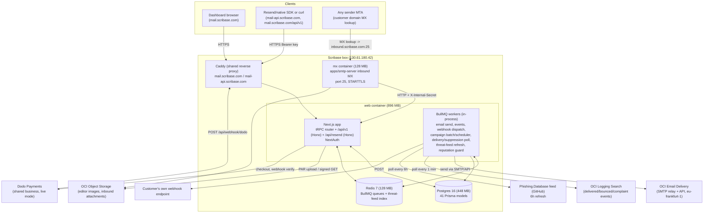

# Scribase Mail Studio — Architecture (2026-10-23)

Source: read from the actual repo at `/Users/arhansubasi/products/scribase-mail-studio`
(fork of useSend). No `PLAN-2026-10-23-DEEP.md` existed at write time — this doc
does not duplicate feature/API planning, only positioning, users, and architecture.

## 0. Confirmed facts (not assumptions)

- Framework: Next.js (App Router) monorepo, pnpm + Turborepo.
  - `apps/web` — dashboard, tRPC app router, REST `/api/v1`, Resend-compatible
    `/api/resend`, NextAuth email-OTP + OAuth.
  - `apps/marketing` — static Next.js marketing site (`scribase.com/mail`).
  - `apps/smtp-server` — standalone Node service: (a) SMTP-relay client used by
    the web app to send, (b) inbound MX server (`INBOUND_ENABLED=true`) that
    receives mail on port 25 and posts it to `apps/web`'s internal API.
  - `apps/docs` — Mintlify docs.
- DB: Postgres 16 via Prisma, 41 models (teams, domains, DKIM keys, emails,
  campaigns, contacts/segments, templates, webhooks, API logs, audit log,
  received emails, billing/subscriptions).
- Queue/cache: Redis 7 (`noeviction`, AOF) + BullMQ. Queues: email send
  (per-region transactional + marketing, split by quota), email-events,
  provider suppression poll, provider delivery-log poll, reputation guard,
  threat-feed refresh, campaign scheduler, campaign batch, contact bulk-add,
  domain verification, webhook dispatch, webhook cleanup.
- Outbound email providers (pluggable, picked per team/domain):
  - `OciEmailProvider` — OCI Email Delivery (SMTP + API), the live default on
    the Scribase box; delivered/bounced/complained events read every minute
    from OCI Logging Search (`DELIVERY_LOG_POLL_CRON`), suppression list
    polled as fallback.
  - `GenericSmtpProvider` — bring-your-own SMTP relay, used in the open-source
    self-host compose stack (`compose.yml`).
- Object storage: OCI Object Storage (editor image uploads via browser PAR,
  and inbound-email attachments), not S3/R2.
- Auth: NextAuth — email one-time-code (passwordless) + OAuth (GitHub/Google).
- Billing: Dodo Payments, live mode, already configured on the box (shared
  Dodo business with other Scribase products). Webhook at
  `/api/webhook/dodo`. Free / Pro $20 / Scale $90, usage meter
  `email.sent` above the monthly threshold.
- Content safety: a screening gate in the send queue (reject/hold) plus a
  first-sends review queue for new teams in cloud mode, backed by a phishing
  domain feed cached in Redis.
- Hosting target: **Oracle box `box` (130.61.180.42)**, NOT Cloudflare
  Workers/Pages and NOT the other listed boxes (`railyard-box`,
  `recoder-micro` are unrelated products). Confirmed live:
  `deploy/DEPLOY.md` + `GROWTH-BLOCKERS-2026-10-18.md` ("Deploy status:
  LIVE", `curl https://mail.scribase.com/api/health` → `{"data":"Healthy"}`).
  Deployed via `docker compose -f deploy/compose.scribase-mail.yml`, fronted
  by the box's shared Caddy (two vhosts: `mail.scribase.com` full app,
  `mail-api.scribase.com` rewritten to `/api/resend/*` only).
- Memory budget is explicit and small: web 896 MB, Postgres 448 MB, Redis
  128 MB, MX server 128 MB — ~1.47 GB total container ceiling on a shared box.

## 1. System diagram

## 2. Data flow for the 2-3 most important user actions

### 2.1 Transactional send (API/SDK call, the core product action)

1. Client calls `POST /api/v1/emails` (native) or `POST /emails` on
   `mail-api.scribase.com` / `/api/resend/emails` (Resend-SDK-compatible),
   `Authorization: Bearer us_...`.
2. Hono route in `apps/web` validates the API key (team + scope: "Sending
   access" keys can only hit send endpoints), validates the payload with
   Zod, resolves `from` against a verified `Domain`.
3. `LimitService` checks plan quota (Free 3k/mo+100/day, Pro 50k, Scale
   100k, warm-up caps for new teams) and `send-gate-service` runs content
   screening (link/attachment/heuristic checks against the Redis-cached
   threat-feed index); cloud-mode new teams additionally get queued to
   `EmailReview` instead of sending.
4. On pass, an `Email` row is written (status `QUEUED`) and a BullMQ job is
   pushed onto the team's region+type queue (`transactionalQueue` /
   `marketingQueue`, split by per-region quota).
5. A BullMQ worker (in the same `web` container process) picks the job,
   builds headers/tracking pixels, and calls the resolved provider —
   `OciEmailProvider` (SMTP/API to OCI Email Delivery) or
   `GenericSmtpProvider` (self-host) — updates `Email.status` to `SENT` or
   records a `ProviderSendError`.
6. Every ~1 minute, `provider-delivery-log-poll-job` queries OCI Logging
   Search for `OutboundRelayed`/bounce/complaint events for verified
   domains, dedupes via `ProcessedProviderLogEvent`, writes `EmailEvent`
   rows, and flips `Email.status` to `DELIVERED`/`BOUNCED`/`COMPLAINED`.
   `provider-suppression-poll-job` is the fallback path on the same cadence.
7. Each status change enqueues a `webhook-dispatch` job that POSTs the event
   to the customer's configured `Webhook` URL (SSRF-guarded: public IPs
   only unless explicitly allow-listed) and records a `WebhookCall`.
8. Opens/clicks are tracked first-party: `/api/t/o/[emailId]` (pixel) and
   `/api/t/c/[emailId]` (redirect) write `EmailEvent` rows directly —
   these never touch OCI.

### 2.2 Campaign/broadcast send (marketing batch to a contact list)

1. User creates a `Campaign` + picks an `Audience`/`Segment` in the
   dashboard (tRPC mutation) or schedules it for later.
2. `campaign-scheduler-job` (cron-driven BullMQ queue) picks up due
   campaigns and fans them out into `campaign-batch` jobs, each batch
   resolving `Contact` rows (respecting `SuppressionList` and unsubscribes)
   and merging `BUILT_IN_CONTACT_VARIABLES` + custom contact properties into
   the template.
3. `campaign-emails-processing` queue turns each resolved contact into a
   `CampaignEmail` + `Email` row and pushes it through the **same** send
   path as 2.1 step 4 onward (content screening, provider send, delivery
   poll, webhook dispatch, tracking).
4. One-click unsubscribe (`/api/unsubscribe-oneclick`, RFC 8058) and the
   hosted `/unsubscribe` page both write to `SuppressionList`, consulted by
   every future campaign batch and by `LimitService`/send-gate checks.

### 2.3 Inbound email receipt (Wave-3 feature, differentiator vs useSend/Resend)

1. Sender's MTA does an MX lookup for the customer domain, finds
   `inbound.scribase.com`, connects on port 25 to the **separate** `mx`
   container (`apps/smtp-server`, 128 MB, its own Docker Compose profile).
2. `smtp-server` does STARTTLS, basic auth/relay checks
   (`auth-check.ts`), parses the message (`mailparser`), extracts
   recipients (`recipients.ts`) and any attachments, and uploads attachment
   bytes to OCI Object Storage (`inbound-storage-service.ts`/`storage.ts`).
3. It then calls back into the `web` container over HTTP:
   `POST /api/internal/inbound` (and `GET .../domains` to know which domains
   accept mail), authenticated only by a shared `INBOUND_INTERNAL_SECRET`
   header — this endpoint is explicitly documented as same-host/private-net
   only and fails closed (503) without the secret set.
4. `persistReceivedEmail` writes `ReceivedEmail` + `ReceivedEmailAttachment`
   rows; the dashboard and `/api/v1`/`/api/resend` expose them as "received
   inbound mail + attachments" (one of the few things Resend's own hosted
   product and useSend's upstream do not offer at all).

## 3. Real architectural risks / bottlenecks at current scale, zero budget

- **Single box, single Postgres, no replica.** `box` (130.61.180.42) runs
  this product's entire stack plus other Scribase products sharing the same
  Caddy and the same OCI tenancy/Dodo business. A box-level incident takes
  down mail sending, inbound receipt, billing webhooks, and the dashboard
  simultaneously; there is no secondary region or standby DB.
- **BullMQ workers run in-process inside the `web` container**, not as a
  separate worker deployment. A traffic spike or a slow campaign batch
  competes for the same 896 MB and same Node event loop as the dashboard
  and the public API — a large campaign send can visibly slow down
  interactive `/api/v1` requests on the same box.
- **896 MB web / 448 MB Postgres / 128 MB Redis is a hard ceiling** chosen
  to fit a shared, already-loaded box. Prisma connection pool size, BullMQ
  concurrency (`quota` per `createQueueAndWorker`), and Postgres
  `shared_buffers` are all implicitly capped by this, not by real load
  testing; there is no autoscaling path on a single VM.
- **OCI Email Delivery is one shared tenancy** ("OCI daily/rate limits
  apply to the whole tenancy, shared with Rally and other products" —
  `deploy/DEPLOY.md`). One abusive team or one noisy sibling product can
  throttle or jeopardize sender reputation for every Scribase Mail
  customer; there's no per-customer dedicated IP/pool beyond the
  "sending pools" feature mentioned in `GROWTH-BLOCKERS-2026-10-18.md`.
- **Delivery event latency and polling, not push.** Delivered/bounced
  events depend on a 1-minute OCI Logging Search poll (plus OCI's own
  ingest delay) and a suppression-list fallback poll — there is no native
  webhook from OCI, so "real-time" delivery status is actually
  near-real-time at best, and a Logging API outage silently degrades to
  the suppression-list poll only.
- **Inbound MX is a second always-on service with its own attack surface**
  (raw port 25 exposed to the internet, needs its own firewall/security-list
  rule on OCI) and its only auth boundary back to the main app is a static
  shared secret header — acceptable for same-host/private-net as documented,
  but it is a single static secret, not per-request signing or mTLS.
- **No CDN/edge in front of `mail.scribase.com`/`mail-api.scribase.com`**
  beyond Cloudflare DNS-proxy (orange cloud) + the box's own Caddy; all
  dashboard, tracking-pixel, and API traffic terminates on the single box.
- **Threat-feed-based content screening is heuristic + a single free feed**
  (Phishing.Database, refreshed every 6h) — commercial-use-restricted feeds
  (Spamhaus, Google Safe Browsing, OpenPhish, abuse.ch) are deliberately
  excluded for license reasons, so detection coverage is weaker than a
  paid deliverability/safety stack would give.

## 4. Prioritized next-build list (effort vs. impact)

1. **(Low effort, high impact) Add the FreeResend comparison row and ship
   it to the two or three directories that already rank for "Resend
   alternative"** — this is pure content/positioning, zero infra risk, and
   directly executes `growthMoves` #1 and #3 from the strategy doc using
   architecture already fully built (Resend-compatible API, migration
   guide at `/mail/migrate-from-resend`, live since the first deploy).
   No code changes required, just documentation the user (or an agent with
   write access to those directories) submits.
2. **(Low effort, high impact) Instrument and surface delivery-event
   latency on the existing deliverability dashboard.** The
   `provider-delivery-log-poll-job` and `deliverability-insights-service.ts`
   already exist (per `GROWTH-BLOCKERS-2026-10-18.md`); exposing actual
   p50/p95 "time from SENT to DELIVERED" per domain turns an invisible risk
   (section 3, bullet 5) into a selling point against Resend/Postmark for
   the deliverability-conscious persona, with no new infrastructure.
3. **(Medium effort, high impact) Split BullMQ workers out of the `web`
   container into a separate `worker` service in `compose.scribase-mail.yml`**,
   even if it stays on the same box with its own small `mem_limit`. Directly
   addresses the "campaign send slows down the public API" bottleneck
   (section 3, bullet 2) without requiring a second box or any paid
   infrastructure — just a second container sharing the same Postgres/Redis.
4. **(Medium effort, medium impact) Turn the OCI Logging poll into a push
   path where possible** (e.g., subscribe to OCI Logging via a Notifications
   topic instead of polling every minute) to cut delivery-status latency
   and reduce the blast radius of a single poll-job failure — directly
   improves the reliability story used in growth move #2 (helpful answers
   in Resend-SDK GitHub issues about self-hosting cost/latency).
5. **(Higher effort, long-term impact) Give Scribase Mail Studio its own
   dedicated IP/sending pool outside the shared OCI tenancy**, or at least
   per-team OCI compartments, to remove the "one bad sender affects
   everyone" risk called out directly in `GROWTH-BLOCKERS-2026-10-18.md`.
   Zero-budget constraint makes this the lowest priority of the five: it
   likely requires either a second OCI Email Delivery setup or real
   spend, so it should wait until Pro/Scale paid volume justifies it.
